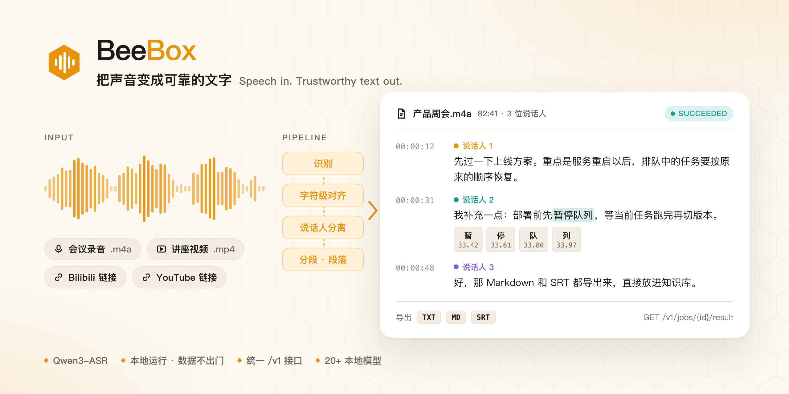

<div align="center">

<picture>
  <source media="(prefers-color-scheme: dark)" srcset="docs/assets/banner-dark.png">
  
</picture>

**A speech transcription service that runs on your own machine.**

Recordings, video files, Bilibili and YouTube links go in. Transcripts with character-level timestamps, speakers, and natural paragraphs come out.<br>
It runs on a single consumer GPU, and your models and data never leave your machine.

<p><a href="LICENSE"></a>   </p>

<p><a href="README.md">简体中文</a> · <a href="#getting-started">Getting started</a> · <a href="#ai-agent-deployment-guide">AI agent deployment</a> · <a href="docs/history.md">Fix and decision history</a> · <a href="CHANGELOG.md">Changelog</a></p>

</div>

---

## Why BeeBox

| | |
| --- | --- |
| 🎯 **Accurate on Chinese** | Built on Qwen3-ASR-1.7B for Chinese meetings, lectures, and interviews, including the English terms mixed into them |
| ⏱️ **Character-level timestamps** | Forced alignment gives every character a start and end time, so subtitles line up exactly with the audio |
| 🗣️ **Knows who is speaking** | pyannote speaker diarization; every paragraph belongs to exactly one speaker |
| 📖 **Reads like prose** | Text is split into sentences, then grouped into natural paragraphs per speaker, without changing a single recognised character |
| 🔗 **Paste a link** | Bilibili and YouTube links work directly. With platform subtitles, results arrive in seconds without touching the GPU; otherwise only the audio track is downloaded and transcribed |
| 💪 **Long recordings survive interruptions** | Long audio is split into chunks and each chunk is saved as it finishes. After a restart, jobs resume from the last chunk and queued jobs stay queued |
| 🔌 **One API for everything** | A single `/v1` HTTP API: upload, create a job, poll, fetch the result. Scripts, apps, and AI agents can call it directly |
| 🔒 **Your data stays home** | All inference is local; source media is deleted after use; LAN access requires a token; platform credentials are write-only |
| 🧩 **More than 20 local models** | Whisper, SenseVoice, Paraformer, FireRedASR2, Granite, Voxtral, and more, chosen by language and speed |
| 🛠️ **Low-maintenance operations** | Runs as a Windows service that starts at boot and restarts after a crash; upgrade or roll back with one command |

## Measured results

All numbers come from real material on an RTX 2080 Ti (a modified 22 GB card); the test records are in the repository:

- **82.7-minute multi-speaker meeting**: transcription, character-level alignment, and diarization took about 13 minutes in total, with peak VRAM around 10 GB. It fits on a 16 GB card.
- **Paragraph quality**: before the rework, 240 segments were hard-cut at a fixed 84-character limit; afterwards there were none. 95.5% of paragraphs end with sentence-final punctuation, and no paragraph mixes two speakers.
- **5-minute three-person conversation**: recognition, alignment, and diarization finished in about 83 seconds.
- **Bilibili video with subtitles**: done in 3 seconds without entering the GPU queue.
- **Never rewrites the text**: concatenating all segments in order reproduces the original recognised text character for character. This is an assertion checked on every run.

## What it is good for

- **Meeting and lecture notes**: transcribe a long recording in one go, split by speaker, and export Markdown straight into your notes.
- **Video notes**: turn courses and interviews on Bilibili and YouTube into searchable, quotable text.
- **Subtitles**: each SRT cue is one sentence, with timing accurate to the character.
- **Giving AI agents ears**: an agent submits jobs through `/v1` and gets back structured results (full text, segments, paragraphs, speakers, source) to summarise, search, or answer questions over.

BeeBox focuses on turning speech into reliable text. Proofreading, translation, and summaries are left to downstream apps or LLMs, which keeps the service small and stable.

---

## Contents

1. [Getting started](#getting-started)
2. [AI agent deployment guide](#ai-agent-deployment-guide)
3. [Technology choices and why](#technology-choices-and-why)
4. [Architecture](#architecture)
5. [Known limitations](#known-limitations)
6. [Roadmap](#roadmap)
7. [Configuration, API, and development](#configuration-api-and-development)

> How problems were found, judged, and fixed during development is written up in the [fix and decision history](docs/history.md) (in Chinese). `#numbers` in the code and docs refer to issues in the private development repository; the mapping is in that document.

---

## Getting started

**Requirements**: Windows 11 x64, an NVIDIA GPU (CUDA-compatible, 16 GB VRAM recommended), [uv](https://docs.astral.sh/uv/) 0.12+, Git for Windows, and ffmpeg / ffprobe. uv provides Python 3.12 from the lock file.

**Production install** (a Windows service that starts at boot and restarts after a crash). Run from the repository root in an elevated PowerShell:

```powershell
powershell -ExecutionPolicy Bypass -File .\deploy\windows\install.ps1 -ModelRoot D:\BeeBoxModels
Invoke-RestMethod http://127.0.0.1:17494/v1/health
```

**Transcribe your first recording**:

```powershell
$h = @{ Authorization = "Bearer $env:BEEBOX_API_TOKEN" }
$file = curl.exe -s -H "Authorization: Bearer $env:BEEBOX_API_TOKEN" -F "file=@meeting.m4a" http://127.0.0.1:17494/v1/files | ConvertFrom-Json
$job = Invoke-RestMethod -Method Post -Headers $h -ContentType 'application/json' `
  -Body (@{ source = @{ type = 'file'; file_id = $file.id } } | ConvertTo-Json) http://127.0.0.1:17494/v1/jobs
Invoke-RestMethod -Headers $h http://127.0.0.1:17494/v1/jobs/$($job.id)            # poll until succeeded
Invoke-RestMethod -Headers $h http://127.0.0.1:17494/v1/jobs/$($job.id)/exports/md # download Markdown
```

For a video link, set `source` to `@{ type = 'url'; url = 'https://www.bilibili.com/video/BV...' }`. You can also open `http://127.0.0.1:17494/console` to upload files, paste links, and watch progress and results.

**Development or a quick run**:

```powershell
uv sync --frozen
$env:BEEBOX_DATA_DIR = "D:\beebox-data"
uv run python -m backend.server --host 127.0.0.1 --port 17494
```

Install parameters, directory layout, upgrades, and rollback are covered in [deploy/windows/README.md](deploy/windows/README.md) (in Chinese).

---

## AI agent deployment guide

Installing, upgrading, and verifying BeeBox is fully scripted, and every step has a result you can check. That makes it a good fit for coding agents such as Claude Code or Codex.

### Prompt for the agent

Open the agent on the target Windows machine and give it this:

```text
Please deploy BeeBox (https://github.com/HUA1255/beebox) on this Windows 11 machine.
First read the "AI agent deployment guide" in README.en.md and deploy/windows/README.md in full, then follow the steps.
Rules:
1. Before any step that needs administrator rights, registers or changes a system service, or downloads several GB, tell me what you will do and wait for my confirmation.
2. Confirm every step with the check described in the guide. If something fails, read the logs to find the cause; do not skip or work around a check.
3. Never print, log, or commit the token in secrets\settings.env or any cookie.
4. When done, report the installed version, the service status, the model status, and the result of the test job.
```

### Steps for the agent

These steps are written for the agent. Each has a "Check"; move on only once it passes.

**1. Inspect the environment (read-only)**

```powershell
[System.Environment]::OSVersion.Version   # Windows 11: build 22000 or later
nvidia-smi                                 # shows an NVIDIA GPU and driver version
uv --version                               # 0.12 or later
git --version
Get-PSDrive -PSProvider FileSystem         # keep at least 20 GB free on the install and model drives
```

Check: every command above produces normal output. If uv or Git is missing, tell the user and let them decide whether to install it.

**2. Get the code and check out the latest release**

```powershell
git clone https://github.com/HUA1255/beebox.git
cd beebox
$tag = git describe --tags --abbrev=0
git checkout $tag
```

Check: `git status` is clean and `$tag` looks like `v1.0.1`.

**3. Prepare external tools and models**

- ffmpeg / ffprobe: a directory or zip containing `ffmpeg.exe` and `ffprobe.exe`.
- Deno 2.4.3+: a directory or zip containing `deno.exe` (needed for video links).
- A model root, for example `D:\BeeBoxModels`. The alignment and diarization models must be placed there in advance:

| Directory | Source | Required files |
| --- | --- | --- |
| `<model root>\models\qwen3-forced-aligner-0.6b` | Hugging Face `Qwen/Qwen3-ForcedAligner-0.6B-hf` | `config.json`, `processor_config.json` or `preprocessor_config.json`, `model.safetensors` |
| `<model root>\models\pyannote-community-1` | Hugging Face `pyannote/speaker-diarization-community-1` (or a ModelScope mirror) | `config.yaml` and the sub-models it references |

The recognition model (default `qwen3-asr-1.7b`) does not need manual preparation; it is downloaded through the API after installation (step 6).

Check: all required files in the table exist.

**4. Rehearse the install (changes nothing)**

```powershell
powershell -ExecutionPolicy Bypass -File .\deploy\windows\install.ps1 -DryRun
```

Check: exit code 0, the output lists every install step, and `C:\BeeBox` was not created.

**5. Install for real (needs administrator rights; ask the user first)**

```powershell
powershell -ExecutionPolicy Bypass -File .\deploy\windows\install.ps1 `
  -ModelRoot D:\BeeBoxModels -FfmpegSource <ffmpeg dir or zip> -DenoSource <deno dir or zip> -Tag $tag
```

Check:

```powershell
Get-Service BeeBox                                   # Status is Running
Invoke-RestMethod http://127.0.0.1:17494/v1/health   # online and ready are True; version matches $tag
```

The installer generates a random token in `C:\BeeBox\secrets\settings.env`, which only administrators can read. Load it into the current session's environment without printing it:

```powershell
$env:BEEBOX_API_TOKEN = ((Get-Content C:\BeeBox\secrets\settings.env | Select-String '^BEEBOX_API_TOKEN=').Line -split '=', 2)[1]
```

**6. Download the recognition model and confirm model status**

```powershell
$h = @{ Authorization = "Bearer $env:BEEBOX_API_TOKEN" }
Invoke-RestMethod -Method Post -Headers $h http://127.0.0.1:17494/v1/models/qwen3-asr-1.7b/download
Invoke-RestMethod -Headers $h http://127.0.0.1:17494/v1/models/qwen3-asr-1.7b   # poll until the download finishes
```

Check: `GET /v1/models/qwen3-asr-1.7b` returns `downloaded` and `complete` as `True`, with an empty `missing_files`. Note that `ready` in `/v1/health` only means the database and storage are usable; use `/v1/models` to see whether the models are in place.

**7. End-to-end acceptance**

Take a 1–5 minute recording and use the commands in [Getting started](#getting-started) to upload it, create a job, poll, and fetch the result.

Check: the job reaches `succeeded`, `/v1/jobs/{id}/result` contains segments and paragraphs, and `exports/txt`, `exports/md`, and `exports/srt` all download. Afterwards, delete the test job with `DELETE /v1/jobs/{id}`.

**8. Optional features**

- **Bilibili login**: scan the QR code on the "Platform credentials" page at `http://127.0.0.1:17494/console`. The user must scan it on their own phone.
- **YouTube without login**: check out the bgutil provider as described under "YouTube 免登录与年龄限制 cookie" in [deploy/windows/README.md](deploy/windows/README.md).
- **LAN access**: the service listens on `0.0.0.0:17494` by default; other machines call it with the same Bearer token. Do not expose it to the internet.

**9. Upgrade and roll back**

```powershell
powershell -NoProfile -ExecutionPolicy Bypass -File .\deploy\windows\deploy.ps1 -Tag <new version> -DryRun
powershell -NoProfile -ExecutionPolicy Bypass -File .\deploy\windows\deploy.ps1 -Tag <new version>
```

The deploy script pauses the queue and waits for the current job to finish, then switches the code, syncs dependencies, migrates the database, restarts the service, and finally checks that `/v1/health` reports the expected version and commit. To roll back, run it again with the previous tag.

### When something goes wrong

- Start with `C:\BeeBox\logs\beebox-server.log` and the WinSW logs in the same directory.
- Common failures and fixes are listed under "故障排查" (troubleshooting) in [deploy/windows/README.md](deploy/windows/README.md).
- Do not edit code in `C:\BeeBox\app` by hand. If that working tree is dirty, the next deployment refuses to run.

---

## Technology choices and why

### Product shape: an API-only service

BeeBox started from the open-source project [asrbox](https://github.com/Goldloli/asrbox) and has been almost entirely rewritten: the web workbench and LLM features were removed, and the service was redesigned around a single `/v1` job API.

**Why API-only**
- Transcription is a building block. It is most useful when other apps and agents can call it, not locked inside yet another workbench.
- Proofreading, translation, and summaries fit better in downstream LLM pipelines. A service that does one thing can do it reliably.
- The bundled console is "just another client" that uses only the public API, so the API has to be sufficient on its own, with no back doors.

### ASR baseline: Qwen3-ASR-1.7B + ForcedAligner + pyannote

| Stage | Choice | Why | Alternatives / why not |
| --- | --- | --- | --- |
| Speech recognition | **Qwen3-ASR-1.7B** (Apache-2.0, fp16) | Clearly more accurate on Chinese meetings and lectures | Whisper large-v3: mature ecosystem but weaker on Chinese; FireRedASR2: strong on Chinese but had immature tooling at the time |
| Timestamps | **Qwen3-ForcedAligner-0.6B** | Qwen3-ASR does not produce precise timestamps itself; the aligner provides character-level ones | — |
| Speaker diarization | **pyannote community-1** (ModelScope mirror available) | Proven on Chinese meetings, no Hugging Face token needed | sherpa-onnx: lighter dependencies but untested; MOSS-Transcribe-Diarize: joint diarization, but it would replace the ASR baseline |

Recognition, alignment, and diarization run as **separate stages** rather than one end-to-end model. Each stage can be replaced, fail, and be measured independently; the cost is that the seams between stages have to be handled explicitly (see [Known limitations](#known-limitations)).

The choice is backed by measurements: the [Gate 1 report](docs/spikes/0001-gate1.md) ran the full chain on an 82.7-minute real recording, with peak VRAM around 8.6 GB for ASR plus alignment and about 1.6 GB for pyannote. See [ADR-0001](docs/adr/0001-qwen3-asr-base.md) and [ADR-0005](docs/adr/0005-pyannote-diarization.md).

### Model catalog: beyond the baseline, pick what fits

- **Whisper family**: five sizes each under transformers and faster-whisper (CTranslate2), including Distil-Whisper (English only)
- **Chinese-first**: SenseVoice Small, Paraformer-large, Fun-ASR-Nano, FireRedASR2-AED 1.1B
- **Multilingual speech-LMs**: Qwen3-ASR 0.6B / 1.7B, Granite Speech 4.1, Cohere Transcribe, ARK-ASR, Voxtral Mini
- **Joint diarization**: MOSS-Transcribe-Diarize 0.9B
- **NeMo (optional runtime)**: Parakeet TDT 0.6B v3, Canary 1B Flash

**Why more than one model**: no model is best across every language, duration, and speed. In our measurements Paraformer is the fastest in the catalog (RTF ≈ 0.1), while Distil-Whisper only suits English and produces made-up English when fed Chinese. Every model **states its real capabilities**: language coverage, timestamp and speaker support, and supported devices, so callers can choose.

**Why weights are not in the repository**: weights run to several GB each and carry different licenses (Apache-2.0, MIT, CC-BY-4.0, vendor model licenses). They are downloaded on demand from ModelScope / Hugging Face, with attribution maintained in [THIRD_PARTY_NOTICES.md](THIRD_PARTY_NOTICES.md). See the [model guide](docs/models.md) and the [model roadmap](docs/asr-models-roadmap.md).

### Deployment: a native Windows service

| Choice | Why |
| --- | --- |
| Native Windows 11, dependencies locked by **uv** | Most consumer GPU machines run Windows. GPU access from Docker on Windows goes through WSL, the image exceeds 20 GB, and it adds a layer to every investigation |
| Hosted as a system service by **WinSW** | Starts at boot, needs no login, restarts 5 seconds after a crash |
| Deploy by **git tag** | Production always runs a clearly identified version, and rolling back means switching to another tag |
| The console build `console/dist` is committed | The production machine needs no Node, and the service uses a single port; CI checks the build matches the source |

Development can happen on the same machine: **development and production instances are strictly isolated**, with separate directories, ports (17495 vs 17494), data, and tokens, while the model directory is shared read-only. See [ADR-0010](docs/adr/0010-windows-native-deployment.md).

### Technology stack

| Layer | Choice | Why |
| --- | --- | --- |
| Web framework | FastAPI + Uvicorn | Generates OpenAPI natively, so the contract can be a snapshot test; Pydantic validates everything |
| Storage | SQLite (SQLAlchemy) + a local data directory | A single machine needs no separate database process; backup means copying a directory |
| Inference | PyTorch / transformers / CTranslate2 / FunASR | The official inference paths for every model in the catalog |
| Media | ffmpeg / ffprobe | The de facto standard with the widest format coverage |
| Video links | yt-dlp + bgutil (YouTube PO tokens) + bilibili-api (QR login) | Gets platform subtitles and high-quality audio tracks; versions are pinned |
| Dependency management | uv + `uv.lock` | Reproducible and fast; production and development share the same lock file |
| Console | React + Vite + TypeScript, Playwright end-to-end tests | A lightweight single-page app that uses only the public API |

### Security and data

- On a non-loopback address the service **refuses to start without a Bearer token**, so it never ends up open on your LAN by accident; tokens in URL query parameters are not accepted, which keeps them out of logs.
- When a browser or media player cannot send headers, it uses a ticket that is valid for 60 seconds, single-use, and bound to one path.
- **Source media and temporary audio are deleted as soon as a job succeeds**; results are kept for 30 days by default, then cleaned up automatically.
- Platform credentials for downloads (Bilibili and YouTube cookies) are **write-only**: never echoed by the API, never logged, never stored in the database.

See [ADR-0011](docs/adr/0011-lan-token-and-retention.md) and [Privacy and local data](docs/privacy.md).

---

## Architecture

### Layered overview

```mermaid
flowchart TB
    subgraph Clients[Clients]
        app[Your app / service]
        script[Scripts / AI agents]
        console[Console /console]
    end

    subgraph API["/v1 API layer (backend/v1)"]
        files["/v1/files"]
        jobs["/v1/jobs"]
        models["/v1/models"]
        queue["/v1/queue · /v1/health"]
    end

    subgraph Services[Service layer (backend/services)]
        tasks[Job lifecycle tasks]
        video[Video links video_jobs]
        gpuq[GPU queue gpu_queue<br/>FIFO · concurrency 1]
        pipeline[Media → chunks → merge → post-processing<br/>→ segments → paragraphs → export]
        mgr[Model management models]
        ret[Retention cleanup retention]
    end

    subgraph Engine[SpeechEngine boundary]
        local[local: real models]
        fake[fake: test double]
    end

    worker[Inference subprocess<br/>local_task_worker<br/>heartbeat + unload]
    backends[ASR backends · aligner · pyannote<br/>backend/backends]
    store[(SQLite + data directory<br/>uploads / derived audio / exports)]

    Clients -->|HTTP + Bearer token| API
    API --> Services
    tasks --> gpuq --> pipeline
    video -->|platform subtitles: no GPU| pipeline
    video -->|no subtitles: audio track only| gpuq
    pipeline --> Engine
    local --> worker --> backends
    Services --> store
```

### How a transcription job flows

```text
POST /v1/files (streaming upload)
  └─ POST /v1/jobs  → status queued, enters the GPU queue
       └─ preprocessing   ffprobe preflight + ffmpeg conversion to a uniform WAV
       └─ waiting_model   download / load the model when needed
       └─ transcribing    long audio is split into 120 s windows with 2 s overlap, inferred chunk by chunk, progress saved
                          → forced alignment produces character-level timestamps
                          → merge and deduplicate across chunks
       └─ diarize         (optional) pyannote speaker diarization, then assign speakers to the text
       └─ post-processing sentence-level segments (sentence-final punctuation > pause > length cap) → paragraphs per speaker
       └─ exporting       TXT / Markdown by paragraph, SRT by segment
  └─ succeeded: delete source media and temporary audio; keep results for 30 days
```

A video-link job decides its path before it is queued: if the platform has usable manual or automatic subtitles, they are converted directly into the same segments and paragraphs, **without using the GPU at all**. Only when no usable subtitles exist, or the caller sets `prefer=asr`, is the audio track downloaded and run through the recognition pipeline above.

### Key design decisions

**① Every capability shares one job resource and one GPU queue** ([ADR-0009](docs/adr/0009-unified-job-api.md))

- On a single 16 GB card, two processes loading models independently would run each other out of VRAM, so **one process owns queueing and model loading and unloading**.
- The queue is strictly first-in-first-out with concurrency 1, and it can be paused: the current job finishes, new jobs keep queueing, and work resumes when the queue does. The queue is paused before deployments and real-model tests.
- The public surface is just `/v1/jobs` (with `kind` selecting the capability) and `/v1/files`. Adding text-to-speech later means adding one more `kind`; jobs, progress, files, auth, and model management are all reused, and callers keep a single polling loop.
- There are only five public states: `queued / running / succeeded / failed / cancelled`. Details live in `stage`, `progress`, `error_code`, and `retryable`, and every error has the same shape `{detail, error_code, stage}`. The caller's state machine stays simple while internal stages are free to evolve.

**② SpeechEngine: the only boundary between the pipeline and the models**

The pipeline never imports a model runtime directly; it builds a `SpeechRequest` and consumes a `TranscriptionResult`. Behind the boundary are two implementations: `local` wires up the real recognition, alignment, and diarization models; `fake` is a scripted double that returns preset segments, speakers, or failures.

As a result, the genuinely complex logic (chunking, merging, post-processing, paragraphs, export) is tested with real code in CI with **no GPU, no models, and no network**.

**③ Inference runs in a separate subprocess with a liveness heartbeat**

- A model crash, a VRAM leak, or a CUDA deadlock cannot take down the API process, and when a job ends the subprocess exits, so VRAM is always fully released.
- A live process is not necessarily a working one: a deadlocked inference process is still alive. The worker reports its accumulated CPU time as a heartbeat; only when the heartbeat stops growing, or a hard limit passes with no output, is it judged stalled and terminated. Slow chunks are not killed by mistake, and stuck chunks do not hold the queue forever.

**④ Chunks saved as they finish, with resume from the last chunk**

Long recordings are split into 120-second chunks with 2 seconds of overlap, and each chunk's result and state are written to the database. After a restart or crash, a job resumes from the last completed chunk, and queued jobs are restored in their original order. For an 80-minute recording, a failure costs at most two minutes of rework instead of starting over.

**⑤ Two levels of text: segments and paragraphs** ([ADR-0007](docs/adr/0007-paragraph-contract.md))

- A **segment** is roughly one sentence, belongs to one speaker, and is the unit of subtitles and timing (one SRT cue per segment).
- A **paragraph** groups consecutive segments from the same speaker, targets 10 to 120 seconds, and is the unit of reading and export (TXT / Markdown are written by paragraph).

Subtitles need to be short and reading needs to be long. With only one level, either one subtitle spans several lines or the reading text breaks into one sentence per line.

**⑥ The API contract is a snapshot**

`openapi.json` at the repository root is a committed snapshot of the API, and tests fail when the implementation drifts from it. Compatibility is guarded by tests rather than by remembering to update docs, and every API change shows up clearly in the review diff.

**⑦ Polling first, no webhooks**

Polling `GET /v1/jobs/{id}` is the standard approach, with an optional SSE event stream. Polling is simple and reliable, while webhooks would bring callback addresses, retries, and auth, which is not worth the complexity.

### Directory layout

```text
backend/
  v1/                  /v1 routes, request/response schemas, error codes
  services/            job lifecycle, GPU queue, media and chunking, merging, post-processing,
                       segments/paragraphs, export, model management, video platforms, Bilibili login, retention
  backends/            model registry and local ASR engine dispatch (local_asr)
  database/            SQLite models and migrations
  vendor/fireredasr2/  minimal FireRedASR2 inference code (upstream Apache-2.0)
  tests/               default tests (fake engine and platforms, no GPU or network)
  real_tests/          real-model / real-platform tests and result records
console/               console source (React) and its committed build in dist/
deploy/windows/        install, deploy, and dev-instance scripts plus the WinSW template
docs/                  ADRs, model guide, privacy, CI, roadmap, spike report, fix history
openapi.json           API contract snapshot
```

---

## Known limitations

- **Platform**: Windows 11 + NVIDIA GPU is currently the only supported production environment. macOS / Linux can be used for development and some model verification.
- **Queue**: one GPU, one queue, concurrency 1, no priorities; a long job blocks the GPU jobs behind it. Video jobs with platform subtitles are not affected.
- **Users**: a single token, with no multiple users, permission levels, or quotas. Not suitable for exposure to the internet.
- **Diarization**: short interjections and hosts can be split into several labels, speaker changes can cut a sentence in two, and overlapping speech may be attributed inaccurately.
- **Timestamps**: models that do not emit timestamps natively (such as Fun-ASR-Nano and Cohere Transcribe) currently get only segment-level timing.
- **Real time**: no streaming or real-time transcription; only files and links.
- **Models**: NeMo models (Parakeet, Canary) have not been verified on real CUDA hardware; FireRedASR2 accepts at most 60 seconds per input; some Hugging Face models need extra authorisation or a mirror.
- **Video platforms**: Bilibili and YouTube integrations rely on undocumented APIs and can break when the platforms change. Bilibili login needs a fresh QR scan roughly every 180 days ([ADR-0012](docs/adr/0012-bilibili-login-refresh.md)); age-restricted YouTube videos need an uploaded cookie.
- **Results**: transcripts cannot be edited once produced; exports are TXT / Markdown / SRT.

---

## Roadmap

Model expansion is covered in the [model roadmap](docs/asr-models-roadmap.md).

**Near term: closing quality gaps**
- **General-purpose forced alignment**: any model that does not emit timestamps can run an alignment pass after transcription and get character-level timing. One investment, and every model benefits.
- **Diarization post-processing**: merge very short turns, stabilise speaker labels, mark overlapping speech, and smooth sentence boundaries at speaker changes.
- **Real CUDA verification of the NeMo models**, to decide whether Parakeet / Canary join the official catalog.

**Medium term: new capabilities on the same backbone**
- **Text-to-speech (TTS)**: added as a new `kind` under `/v1/jobs`, sharing files, jobs, the GPU queue, and model management with transcription.
- **MCP adapter**: a thin MCP layer on top of `/v1` so AI agents can call BeeBox without writing code.
- **More models**: Granite Speech 5, Canary-1B-v2, Voxtral Small 24B, and others, each evaluated on honest capability claims, license compliance, and manageable size.

**Longer term**
- Queue priorities or preemption (for example, letting short jobs jump ahead).
- Streaming / near-real-time transcription.
- Splitting the two large modules `services/tasks.py` and `backends/local_asr.py` so each pipeline stage is easier to test and replace on its own.

---

## Configuration, API, and development

### Environment variables

| Variable | Purpose |
| --- | --- |
| `BEEBOX_DATA_DIR` | Data directory: database, uploads, derived audio, exports, and caches |
| `BEEBOX_API_TOKEN` | Bearer token; required on a non-loopback address, and once set every `/v1` endpoint except health requires it |
| `BEEBOX_MODEL_STORAGE_ROOT` | Storage root for models and framework caches |
| `BEEBOX_RETENTION_DAYS` | Days to keep results, default 30 |
| `BEEBOX_DOWNLOAD_PROXY` | HTTP(S) proxy for video metadata, subtitle, and audio downloads; direct connection when unset, and the proxy address never appears in results or logs |

See `.env.example`. The service does **not** read `.env` automatically; export the variables into the environment before starting it.

### Common endpoints

| Endpoint | Purpose |
| --- | --- |
| `GET /v1/health` | Online, ready, version, GPU, queue, and Bilibili login status |
| `POST /v1/files` | Streaming upload; returns a file id and metadata |
| `POST /v1/jobs` | Create a job from a file or a video link |
| `GET /v1/jobs` · `GET /v1/jobs/{id}` | Job list / status, stage, and progress |
| `GET /v1/jobs/{id}/result` | Structured result (full text, segments, paragraphs, speakers, source) |
| `GET /v1/jobs/{id}/exports/{fmt}` | Export `txt` / `md` / `srt` |
| `GET /v1/models` | Local model status; download, cancel, retry, unload, and delete |
| `GET /v1/queue` | GPU queue status; `/pause` and `/resume` control it |
| `GET /v1/errors` | Every error code with its meaning and whether it is retryable |

The full contract is in [`openapi.json`](openapi.json). After changing routes or models, regenerate and commit it:

```powershell
uv run python scripts/export_openapi.py
```

### Tests

```powershell
uv run pytest backend/tests -q          # default tests: fake engine and platforms, no GPU, models, or network
cd console; npm ci; npm run build       # after changing console source, rebuild and commit console/dist
```

Real-model tests require your own lawfully obtained media and pre-downloaded models, and are not part of the default suite. Every PR runs the full CI on `windows-latest`; see [docs/ci.md](docs/ci.md).

### Further reading

- [docs/history.md](docs/history.md): fix and decision history, in Chinese (workflow, representative fixes, issue-number mapping)
- [AGENTS.md](AGENTS.md): development conventions and workflow (the single entry point)
- [GLOSSARY.md](GLOSSARY.md): domain terms
- [docs/adr/](docs/adr/): architecture decision records (currently active: 0007–0013)
- [docs/models.md](docs/models.md): model guide and verification records
- [docs/privacy.md](docs/privacy.md): privacy and local data

## License

The source code is licensed under [GPL-3.0](LICENSE) (GPL-3.0-only), copyright Feng. The project started from the MIT-licensed asrbox 0.4.0; upstream attribution is in [NOTICE.md](NOTICE.md). FFmpeg, models, and other third-party components are governed by their own licenses; model weights are not distributed with the repository.
