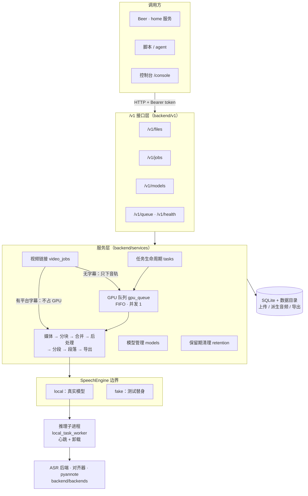

<div align="center">

# BeeBox

**本地优先的家用语音 AI 服务**

在家里的 Windows GPU 主机上把音频、视频、B 站 / YouTube 链接转成带时间戳与说话人的转写稿。<br>
只通过 `/v1` HTTP 接口对外提供能力；模型与数据都留在本机，不依赖任何外部托管服务。

<p><a href="LICENSE"></a>  </p>

<p><a href="README.en.md">English</a> · <a href="CHANGELOG.md">更新日志</a> · <a href="docs/adr/">架构决策记录</a> · <a href="GLOSSARY.md">术语表</a></p>

</div>

---

## 目录

1. [它是什么、不是什么](#1-它是什么不是什么)
2. [方案选型与理由](#2-方案选型与理由)
3. [整体架构与理由](#3-整体架构与理由)
4. [现在的局限性](#4-现在的局限性)
5. [未来拓展方向](#5-未来拓展方向)
6. [快速上手](#6-快速上手)
7. [配置、接口与开发](#7-配置接口与开发)

> 开发过程中问题是怎么发现、判断和修复的，见[修复与决策历史](docs/history.md)。代码和文档里的 `#编号` 指私有开发仓库的 issue，对照表也在那份文档里。

---

## 1. 它是什么、不是什么

BeeBox 是一个**单用户自用的后端服务**。调用方是 Beer 的家里服务（home）、脚本、agent，以及仓库自带的控制台。

| 做 | 不做 |
| --- | --- |
| 语音转写：音频 / 视频文件、B 站与 YouTube 单个视频链接 | 字幕编辑、版本历史、改稿（改稿在 Obsidian 里完成） |
| 字符级时间戳、可选说话人分离 | 声纹识别（判断“谁”是真实身份） |
| 句子级分段 + 段落，导出 TXT / Markdown / SRT | AI 校对、翻译、摘要、会议纪要等 LLM 加工（由调用方负责） |
| 本地模型的下载、加载、卸载与删除 | 在线 ASR、多租户、对公网开放 |

一句话：**BeeBox 只负责“把声音可靠地变成带时间轴的文字”，其余都交给调用方。** 这条边界来自 [ADR-0008](docs/adr/0008-beebox-voice-service.md)，是后面所有选型的前提。

---

## 2. 方案选型与理由

### 2.1 产品形态：只提供接口的后端，而不是工作台

项目前身是带完整网页工作台的 Verbatim / asrbox，有字幕编辑、AI 校对、翻译、聊天、批量任务、MCP 等功能。1.0 把这些全部删掉，只留 `/v1` 接口。

**为什么**
- 实际唯一的重度调用方 Beer 一个工作台功能都不用；保留它们只会扩大维护面，还会误导参与开发的 agent。
- LLM 类加工与 home 已有的 LLM 管线重复，放两处只会两处都不好维护。
- 控制台降级为“又一个调用方”，只用公开接口。这样接口本身就要够用，不会出现“后门接口”。

**考虑过的方案**：保留工作台继续扩展（功能全但没人用）、只删 UI 保留全部后端能力（接口面仍然巨大）。

### 2.2 ASR 基座：Qwen3-ASR-1.7B + ForcedAligner + pyannote

| 环节 | 选择 | 理由 | 备选 / 为什么没选 |
| --- | --- | --- | --- |
| 语音识别 | **Qwen3-ASR-1.7B**（Apache-2.0，fp16） | 主要素材是中文会议、讲座，Qwen3-ASR 的中文准确率明显更好 | Whisper large-v3：生态成熟但中文不及；FireRedASR2：中文强但当时工具链薄 |
| 时间戳 | **Qwen3-ForcedAligner-0.6B** | Qwen3-ASR 本身不出精确时间戳；对齐器能给到字符级，便于切句与做字幕 | — |
| 说话人分离 | **pyannote community-1**（ModelScope 镜像） | 中文会议实测可用，不需要 Hugging Face token | sherpa-onnx：依赖轻但未实测，留作备选；MOSS-Transcribe-Diarize：联合分离，但会替换掉 ASR 基座 |

识别、对齐、分离**分阶段**执行，而不是用一个端到端模型。好处是每一段都能单独替换、单独失败、单独度量；代价是要自己处理阶段间的拼接（见 [局限性](#4-现在的局限性)）。

选型有实测支撑：[Gate 1 报告](docs/spikes/0001-gate1.md) 用一段 82.7 分钟的真实录音跑通全链路，ASR + 对齐峰值显存约 8.6 GB，pyannote 约 1.6 GB，16 GB 显卡放得下。详见 [ADR-0001](docs/adr/0001-qwen3-asr-base.md)、[ADR-0005](docs/adr/0005-pyannote-diarization.md)。

### 2.3 多模型目录：基座之外，按需可选

除了基座，服务还注册了一批本地模型，供不同语言和速度需求选用：

- **Whisper 系**：transformers / faster-whisper（CTranslate2）各五档，含 Distil-Whisper（仅英文）
- **中文优先**：SenseVoice Small、Paraformer-large、Fun-ASR-Nano、FireRedASR2-AED 1.1B
- **speech-LM 多语言**：Qwen3-ASR 0.6B/1.7B、Granite Speech 4.1、Cohere Transcribe、ARK-ASR、Voxtral Mini
- **联合分离**：MOSS-Transcribe-Diarize 0.9B
- **NeMo（可选 runtime）**：Parakeet TDT 0.6B v3、Canary 1B Flash

**为什么不只用一个模型**：没有哪个模型在所有语言、时长、速度上都最好。例如实测 Paraformer 是目录里最快的（RTF ≈ 0.1），Distil-Whisper 只适合英文，用于中文会“幻听”出英文。目录里的每个模型都**如实声明**语言覆盖、时间戳 / 说话人能力和支持的设备，调用方按需挑选。

**为什么权重不进仓库、不进安装包**：权重动辄数 GB，许可证各不相同（Apache-2.0、MIT、CC-BY-4.0、模型专有协议）。按需从 ModelScope / Hugging Face 下载，并在 [THIRD_PARTY_NOTICES.md](THIRD_PARTY_NOTICES.md) 维护署名。详见 [模型指南](docs/models.md) 和 [模型路线图](docs/asr-models-roadmap.md)。

### 2.4 部署：Windows 原生服务，不用 Docker

| 选择 | 理由 |
| --- | --- |
| Windows 11 原生 + **uv** 锁定的 venv | GPU 主机本来就是 Windows；Docker 在 Windows 上跑 GPU 要绕 WSL，而且维护一套没人用的容器环境，每次改动都要双环境验证 |
| **WinSW** 托管为系统服务 | 开机自启、崩溃 5 秒后自动重启；之前的“计划任务 + PowerShell 包装”崩了不会自愈 |
| 按 **git tag** 部署 | 线上代码与 main 不会悄悄脱节，回滚就是换 tag |
| 控制台构建产物 `console/dist` 提交进仓库 | 生产机不需要装 Node；只有一个端口，CI 检查产物与源码一致 |

开发也在同一台机器上，所以**开发实例与线上实例严格隔离**：独立目录、端口（17495 vs 17494）、数据和 token，模型目录只读共用。详见 [ADR-0010](docs/adr/0010-windows-native-deployment.md)。

### 2.5 技术栈

| 层 | 选择 | 理由 |
| --- | --- | --- |
| Web 框架 | FastAPI + Uvicorn | 原生生成 OpenAPI，契约可以落成快照测试；Pydantic 统一校验 |
| 存储 | SQLite（SQLAlchemy）+ 本地数据目录 | 单用户、单机，不需要独立数据库进程；备份就是拷目录 |
| 推理 | PyTorch / transformers / CTranslate2 / FunASR | 覆盖目录中所有模型的官方推理路径 |
| 媒体 | ffmpeg / ffprobe | 事实标准，格式覆盖最全 |
| 视频链接 | yt-dlp + bgutil（YouTube PO token）+ bilibili-api（扫码登录） | 能拿到平台字幕和高音质音轨；版本锁定 |
| 依赖管理 | uv + `uv.lock` | 可复现、安装快；生产与开发用同一份锁 |
| 控制台 | React + Vite + TypeScript，Playwright 端到端测试 | 只读公开接口的轻量 SPA |

### 2.6 安全与数据：局域网 token，媒体用完即删

- BeeBox 监听局域网 / Tailscale 地址供 home 调用，因此**监听非回环地址时必须配置 Bearer token 才能启动**；不接受 URL 参数里的 token。
- 浏览器或播放器无法带 Header 时，用 60 秒、单次、绑定路径的临时票据下载。
- **任务成功后立即删除源媒体和临时音频**，结果默认保留 30 天。原件已经由 home 存到 NAS，结果已经写进 Obsidian，BeeBox 不承担长期存储。
- 下载凭证（B 站、YouTube cookie）对调用方**只写不读**：接口不回显、日志不记录、不进数据库。

详见 [ADR-0011](docs/adr/0011-lan-token-and-retention.md)、[隐私与本地数据](docs/privacy.md)。

---

## 3. 整体架构与理由

### 3.1 分层总览



### 3.2 一条转写任务怎么走

```text
POST /v1/files（流式上传）
  └─ POST /v1/jobs  → 状态 queued，进入 GPU 队列
       └─ preprocessing   ffprobe 预检 + ffmpeg 转成统一格式的 WAV
       └─ waiting_model   需要时下载 / 加载模型
       └─ transcribing    长音频按 120s 窗口、2s 重叠切成分块，逐块推理，进度落库
                          → 强制对齐得到字符级时间戳
                          → 跨块合并去重
       └─ diarize         （可选）pyannote 说话人分离，再把说话人归属到文字上
       └─ 后处理          句子级分段（句末标点 > 停顿 > 长度上限）→ 同说话人分组成段落
       └─ exporting       TXT / Markdown 按段落，SRT 按分段
  └─ succeeded：删除源媒体与临时音频，结果保留 30 天
```

视频链接任务在入队之前先决定走哪条路：平台上有可用的人工或自动字幕，就直接转换成同样的分段和段落，**完全不占 GPU**；没有可用字幕，或调用方指定 `prefer=asr`，才只下载音轨，然后走上面的 ASR 流程。

### 3.3 关键设计与理由

**① 所有能力共用一个任务资源和一个 GPU 队列**（[ADR-0009](docs/adr/0009-unified-job-api.md)）

- 机器只有一块 16 GB 显卡。两个进程各自加载模型就会互相 OOM，所以必须由**一个进程统一排队、统一加载卸载**。
- 队列严格先进先出、并发为 1，可以暂停：当前任务跑完，新任务继续排队，恢复后接着跑。部署和真实模型测试前都先暂停线上队列。
- 对外只有 `/v1/jobs`（用 `kind` 区分能力）和 `/v1/files`。以后加 TTS，只是多一个 `kind`，任务、进度、文件、鉴权、模型管理都能复用，调用方也只要写一套轮询。
- 对外状态只有五个：`queued / running / succeeded / failed / cancelled`。细节放在 `stage`、`progress`、`error_code`、`retryable`。错误统一为 `{detail, error_code, stage}`。这样调用方的状态机永远简单，内部阶段可以随便演进。

**② SpeechEngine：流水线与模型之间唯一的边界**

流水线从不直接 import 任何模型运行时，只构造 `SpeechRequest`，消费 `TranscriptionResult`。边界后面有两个实现：

- `local`：真实的 ASR 后端、对齐器和 pyannote；
- `fake`：脚本化的替身，返回预设的分段、说话人或失败。

**为什么**：分块、合并、后处理、段落、导出这些真正复杂的逻辑，都能在**没有 GPU、没有模型、没有网络**的 CI 上用真代码测到。默认测试套件就是这样跑的，真实模型测试单独执行。

**③ 推理放在独立子进程，并带活跃心跳**

- 模型崩溃、显存泄漏、CUDA 死锁不会拖垮 API 进程；任务结束后进程退出，显存一定能释放干净。
- “进程还活着”不等于“还在干活”：推理死锁时进程照样在。worker 把自己累计的 CPU 时间作为心跳上报，心跳冻结或者超过硬上限仍无产出，才判定停滞并终止。慢的分块不会被误杀，卡死的分块也不会一直占着队列。

**④ 分块 + 逐块落库，支持断点续跑**

长录音切成 120 秒、重叠 2 秒的分块，每块的结果和状态都写进数据库。服务重启或崩溃后，任务从上一个完成的分块继续，排队中的任务也会恢复。对一段 80 分钟的录音来说，这意味着最多重跑两分钟，而不是从头再来。

**⑤ 分段与段落两级文本结构**（[ADR-0007](docs/adr/0007-paragraph-contract.md)）

- **分段**接近一句话、只属于一个说话人，是字幕和时间轴的单位（SRT 一条一个分段）。
- **段落**由同一说话人的若干分段组成，目标 10–120 秒，是阅读和导出的单位（TXT / Markdown 按段落渲染）。

**为什么分两级**：字幕需要短，阅读需要长。只有一级的话，要么字幕一条好几行，要么阅读稿碎成一句一行。

**⑥ 契约即快照**

仓库根目录的 `openapi.json` 是提交进仓库的接口快照，`backend/tests/test_openapi_snapshot.py` 在实现与快照不一致时直接失败。接口兼容性靠测试守护，而不是靠文档自觉。改了路由或模型，就要显式重新生成并提交快照，评审时 diff 一目了然。

**⑦ 只轮询，不做 webhook**

调用方轮询 `GET /v1/jobs/{id}` 是标准方式，SSE 作为可选。单用户场景下轮询足够，而 webhook 要处理回调地址、重试、鉴权，复杂度不划算。

### 3.4 目录结构

```text
backend/
  v1/                  /v1 路由、请求/响应 schema、错误码
  services/            任务生命周期、GPU 队列、媒体与分块、合并、后处理、
                       分段/段落、导出、模型管理、视频平台、B 站登录、保留期清理
  backends/            模型注册表（registry）与本地 ASR 引擎分发（local_asr）
  database/            SQLite 模型与迁移
  vendor/fireredasr2/  FireRedASR2 最小推理集（上游 Apache-2.0）
  tests/               默认测试（假引擎、假平台，无需 GPU 与网络）
  real_tests/          真实模型 / 真实平台测试及结果记录
console/               控制台源码（React）与已提交的构建产物 dist/
deploy/windows/        安装、部署、开发实例脚本与 WinSW 模板
docs/                  ADR、模型指南、隐私、CI、路线图、spike 报告
openapi.json           接口契约快照
```

---

## 4. 现在的局限性

### 运行与部署
- **只支持 Windows 11 + NVIDIA GPU 一种形态。** macOS / Linux 能用于开发和部分模型验证，但不是受支持的生产环境。
- **单卡、单队列、并发为 1。** 没有优先级，长任务会挡住后面所有 GPU 任务。只有字幕类视频任务能绕开队列。
- **单用户、单 token。** 没有多用户、权限分级和配额，不适合对公网开放。
- **只轮询**，没有 webhook，SSE 也只是可选项。

### 识别质量
- **说话人分离的拼接问题仍在：** pyannote 对短插话、主持人容易过分割（同一个人被拆成多个标签），说话人切换点可能把一句话切断，重叠语音可能归属不准。
- **通用强制对齐还没做：** 原生不出时间戳的模型（如 Fun-ASR-Nano、Cohere Transcribe、Granite Speech 4.1 基础版）只能得到句段级甚至没有字幕轴，无法统一升级到字符级。
- **不支持实时 / 流式转写**，只做离线文件处理。
- **准确率和速度的结论只对验证过的机器和依赖版本成立**，换硬件或升级上游版本可能表现不同。
- 不做声纹识别，说话人只是匿名编号。

### 模型
- **NeMo 模型（Parakeet、Canary）只通过了单元测试和契约测试，还没有在 CUDA 真机上验证**，`nemo_toolkit` 也不在默认依赖里。
- FireRedASR2 单次输入上限 60 秒，依赖 VAD 切分；Distil-Whisper 只支持英文。
- 部分模型源（例如 Hugging Face 上的 gated 模型）需要额外授权，或者需要镜像源兜底。

### 视频平台
- **B 站登录大约每 180 天需要重新扫码一次。** TV 通道拿到的凭证无法通过 web 接口续期，只能做失效检测，再由 home 发邮件提醒（[ADR-0012](docs/adr/0012-bilibili-login-refresh.md)）。
- 依赖 B 站和 YouTube 的非公开接口，平台一改就可能失效；YouTube 年龄限制视频需要上传 cookie。

### 数据与结果
- **转写稿产出后不可修改**，服务端没有改稿接口。
- **源媒体在成功后即删除**：失败任务如果源媒体已被清理，需要重新提交。
- 导出格式只有 TXT / Markdown / SRT，没有 DOCX 和 VTT。

### 许可与工程
- `bilibili-api-python` 与 bgutil 是 **GPL-3.0**，因此整个项目也采用 GPL-3.0 发布，与它们兼容。
- `services/tasks.py`（约 2500 行）和 `backends/local_asr.py`（约 1700 行）偏大，是后续重构的重点。

---

## 5. 未来拓展方向

按优先级大致排列。进行中的计划以 GitHub Issues 为准，模型扩充见 [模型路线图](docs/asr-models-roadmap.md)。

### 近期：补齐质量短板
- **通用强制对齐后处理**：任何不出时间戳的模型转写完成后，都可以选择再跑一次对齐，把结果升级为带字符级时间轴的分段。对齐失败不影响基础转写成功。一次投入，全部模型受益。
- **说话人分离后处理**：合并短 turn、稳定说话人标签、标记重叠语音，在说话人切换处平滑句子边界。
- **NeMo 模型的 CUDA 真机验证**，决定 Parakeet / Canary 是否进入正式目录。

### 中期：新能力，同一套骨架
- **语音合成（TTS）**：作为 `/v1/jobs` 下的新 `kind` 接入，与转写共用文件、任务、GPU 队列与模型管理（ADR-0009 的设计初衷）。只有依赖实在无法共存时，才考虑拆成独立服务。
- **MCP 薄层**：需要时在 `/v1` 之上写一层薄薄的 MCP 适配，不在服务内部重复实现能力。
- **更多模型候选**：Granite Speech 5（CTC）、granite-speech-4.1-2b-nar（高吞吐）、Canary-1B-v2、Voxtral Small 24B 等。按照“能力如实声明、许可合规、体积可控”的原则逐个评估。

### 长期：按需再说
- 队列优先级或抢占（例如短任务插队），前提是单卡显存约束仍然成立。
- 流式 / 近实时转写。
- 拆分 `tasks.py` 和 `local_asr.py`，让流水线各阶段更容易单独测试和替换。

**不会做的**：工作台式的字幕编辑、LLM 校对 / 翻译 / 摘要、声纹识别。这些属于调用方，详见 [ADR-0008](docs/adr/0008-beebox-voice-service.md)。

---

## 6. 快速上手

**运行要求**：Windows 11 x64、NVIDIA GPU（兼容 CUDA）、Python 3.12（64 位）与 [uv](https://docs.astral.sh/uv/)、`ffmpeg` / `ffprobe`（放在 `PATH` 或服务工具目录）。

**生产安装**（WinSW 服务、开机自启、崩溃自动重启），详见 [deploy/windows/README.md](deploy/windows/README.md)：

```powershell
powershell -ExecutionPolicy Bypass -File .\deploy\windows\install.ps1 -ModelRoot <现有模型存储根>
```

**开发或临时运行**：

```powershell
uv sync --frozen
$env:BEEBOX_DATA_DIR = "D:\beebox-data"
uv run python -m backend.server --host 127.0.0.1 --port 17494
curl.exe http://127.0.0.1:17494/v1/health
```

开发实例请使用 `deploy\windows\dev-instance.ps1`（端口 17495，与线上隔离），见 [AGENTS.md](AGENTS.md)。

---

## 7. 配置、接口与开发

### 环境变量

| 变量 | 说明 |
| --- | --- |
| `BEEBOX_DATA_DIR` | 数据目录：数据库、上传、派生音频、导出与缓存 |
| `BEEBOX_API_TOKEN` | Bearer token；监听非回环地址时必填，配置后除健康检查外的 `/v1` 接口都需要鉴权 |
| `BEEBOX_MODEL_STORAGE_ROOT` | 模型与框架缓存的存储根 |
| `BEEBOX_RETENTION_DAYS` | 结果保留天数，默认 30 |
| `BEEBOX_DOWNLOAD_PROXY` | 视频元数据、字幕与音轨下载使用的 HTTP(S) 代理；不配置则直连，代理地址不写入结果或日志 |

示例见 `.env.example`。服务**不会**自动读取 `.env`，启动前请把变量导出到环境中。

### 常用接口

| 接口 | 用途 |
| --- | --- |
| `GET /v1/health` | 在线、就绪、版本、GPU、队列、B 站登录状态 |
| `POST /v1/files` | 流式上传，返回文件 id 与元数据 |
| `POST /v1/jobs` | 以文件或视频链接为来源创建任务 |
| `GET /v1/jobs` · `GET /v1/jobs/{id}` | 任务列表 / 状态、阶段与进度 |
| `GET /v1/jobs/{id}/result` | 结构化结果（全文、分段、段落、说话人、来源） |
| `GET /v1/jobs/{id}/exports/{fmt}` | 导出 `txt` / `md` / `srt` |
| `GET /v1/models` | 本地模型状态、下载、卸载与删除 |
| `GET /v1/queue` | GPU 队列状态；`/pause`、`/resume` 控制队列 |

完整契约见 [`openapi.json`](openapi.json)。修改路由或模型后重新生成并提交：

```powershell
uv run python scripts/export_openapi.py
```

### 测试

```powershell
uv run pytest backend/tests -q          # 默认测试：假引擎、假平台，不需要 GPU、模型或网络
cd console; npm ci; npm run build       # 改了控制台源码后重新构建并提交 console/dist
```

真实模型测试需要自行准备合法媒体并预先下载模型，不属于默认测试。

### 延伸阅读

- [docs/history.md](docs/history.md)：修复与决策历史（工作方式、典型修错案例、issue 编号对照）
- [AGENTS.md](AGENTS.md)：开发规范与流程（唯一入口）
- [GLOSSARY.md](GLOSSARY.md)：领域术语
- [docs/adr/](docs/adr/)：架构决策记录（当前有效：0007–0013）
- [docs/models.md](docs/models.md)：模型指南与验证记录
- [docs/privacy.md](docs/privacy.md)：隐私与本地数据

## License

源代码采用 [GPL-3.0](LICENSE)（GPL-3.0-only），版权归 Feng 所有。项目起步于 MIT 许可的 asrbox 0.4.0，之后已大幅重写，上游署名见 [NOTICE.md](NOTICE.md)。FFmpeg、模型及其他第三方组件分别受各自许可证约束；模型权重不随仓库分发。
